# 功能界面预览

当前版本：2026.10.27.1。截图来自实际界面，商品和任务内容为演示数据，不代表真实模型生成质量。

[返回功能说明](../README.md)

## 首页与全局设置

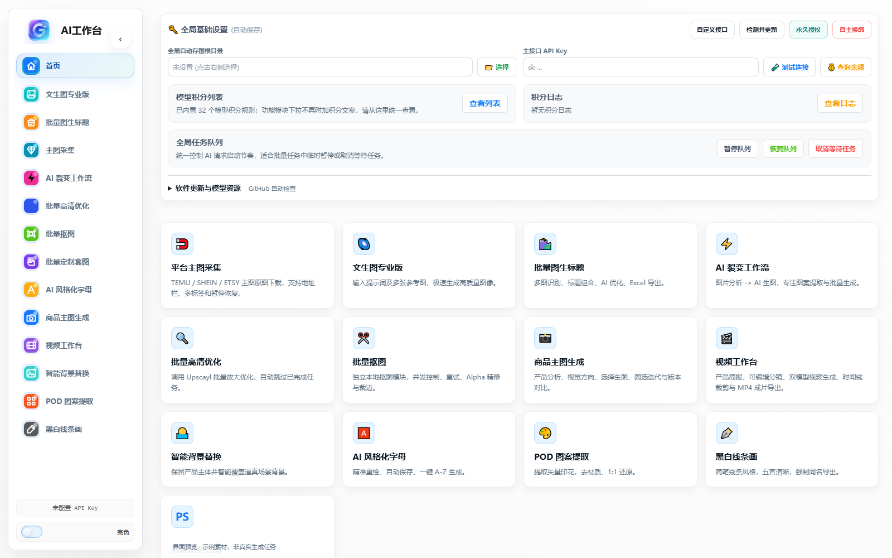

## 文生图专业版

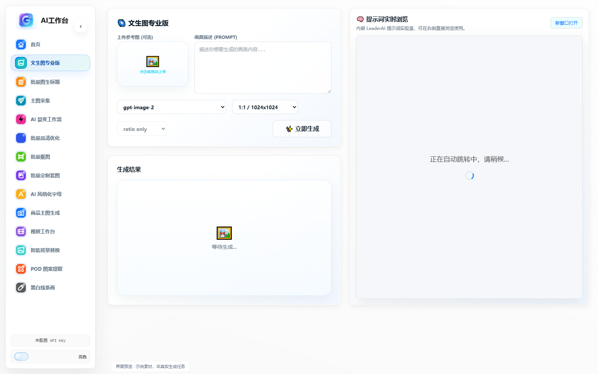

## 批量图生标题

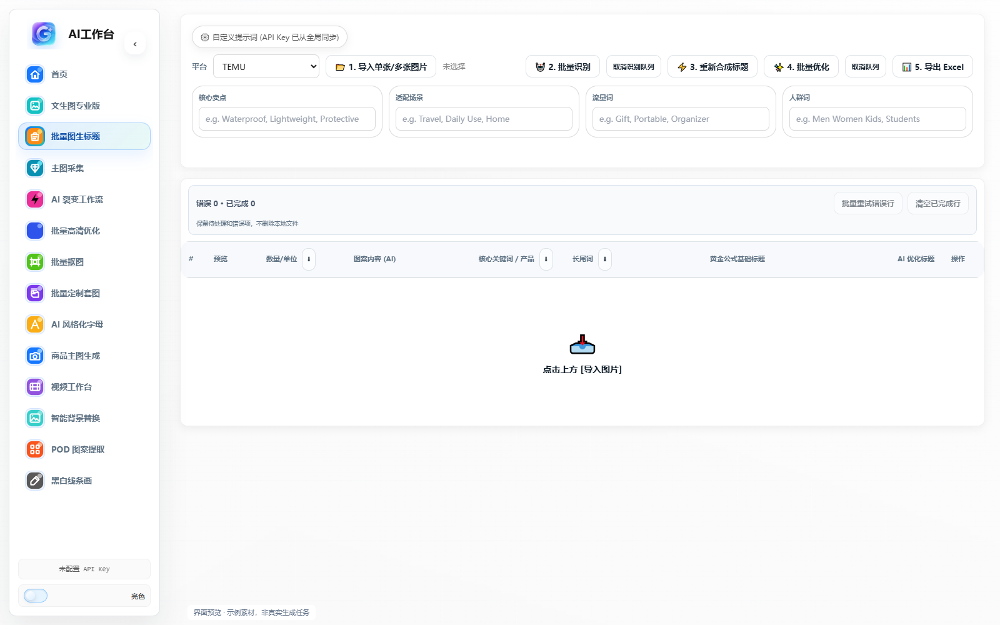

## 主图采集

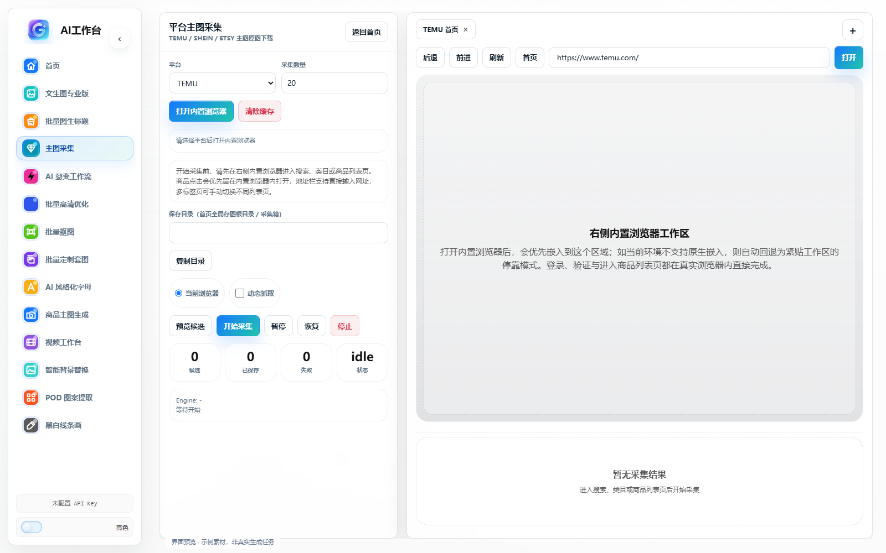

## AI 裂变工作流

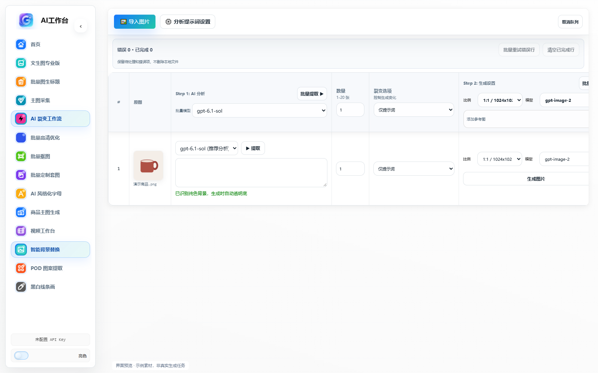

## 批量高清优化

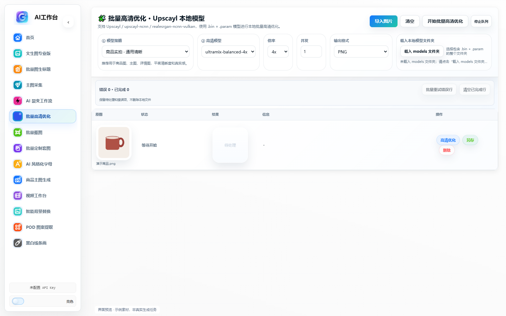

## 批量抠图

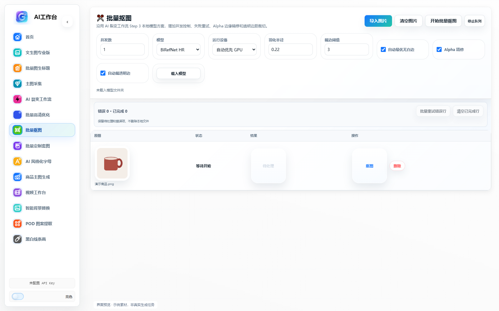

## 批量定制套图

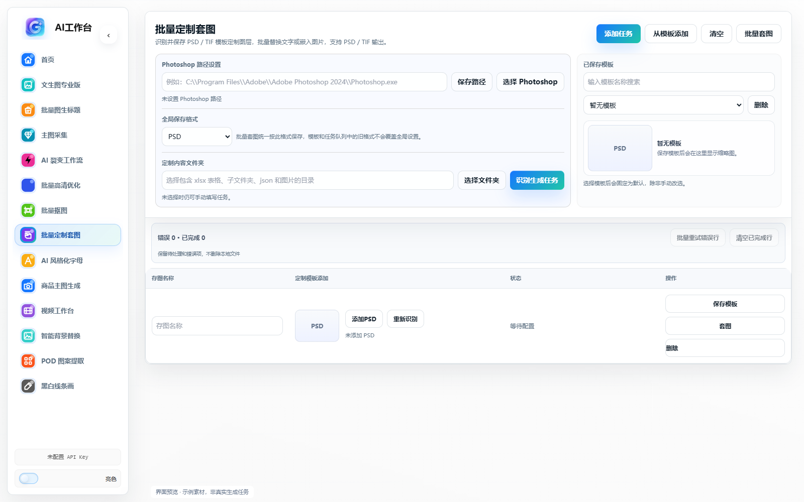

## AI 风格化字母

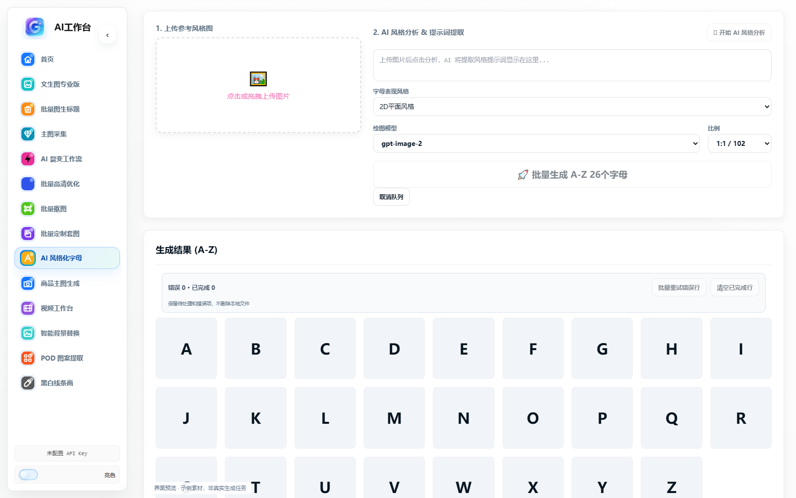

## 商品视觉工作台

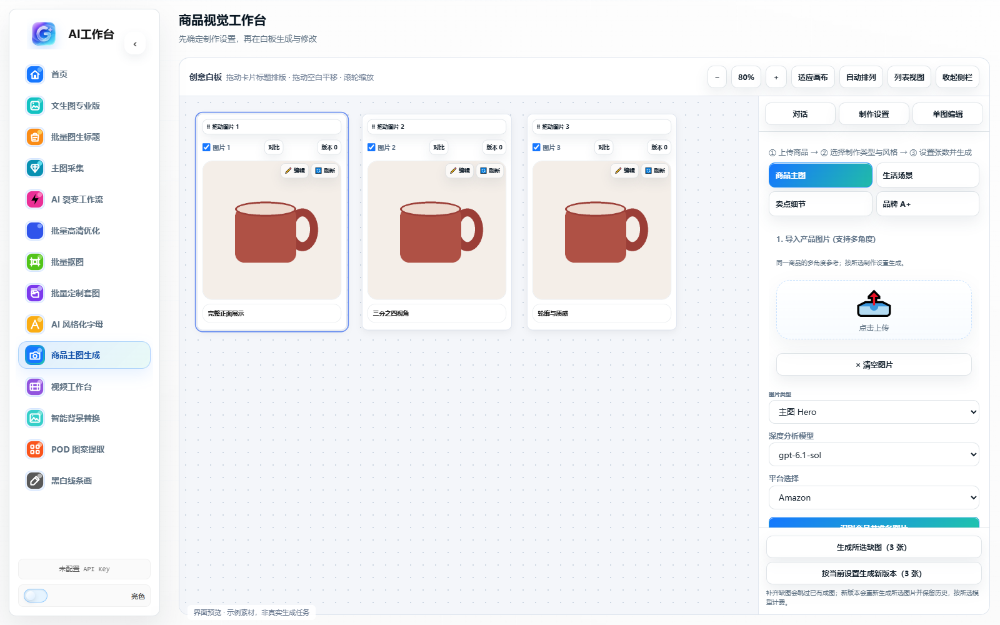

## 视频分镜制作

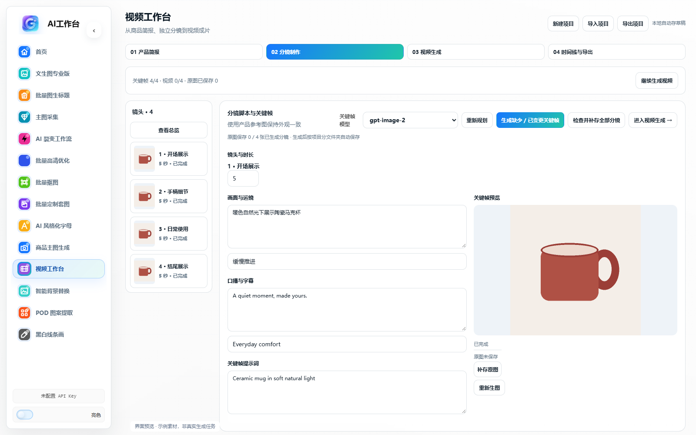

## 智能背景替换

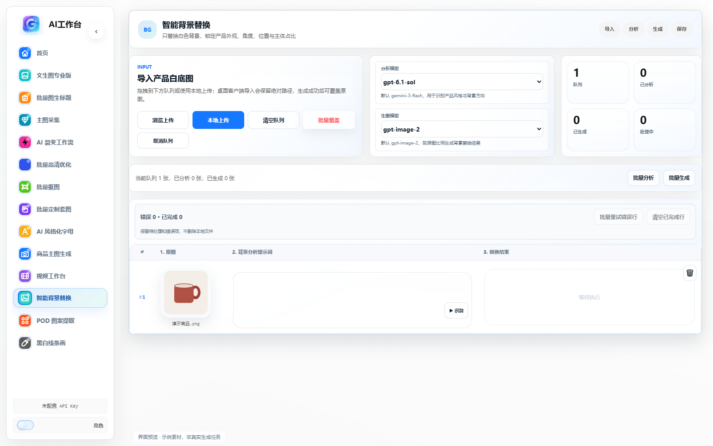

## POD 图案提取

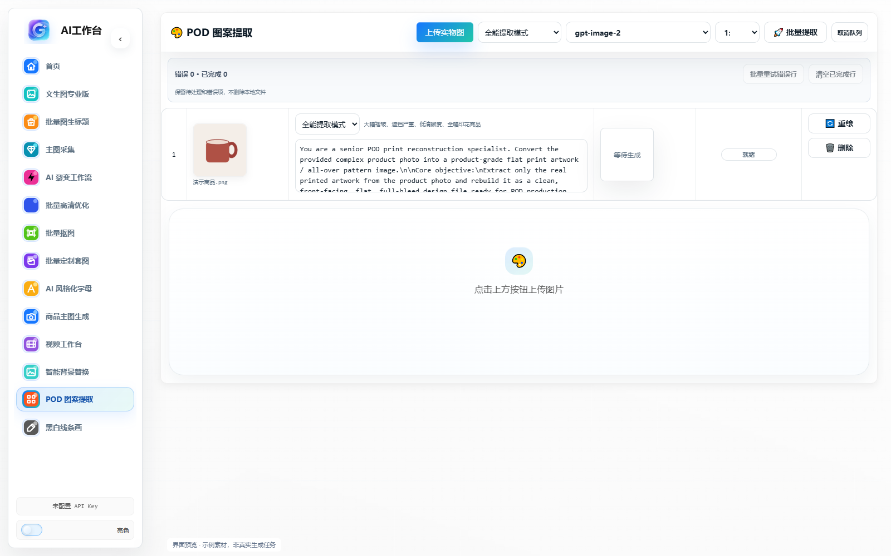

## 黑白线条画

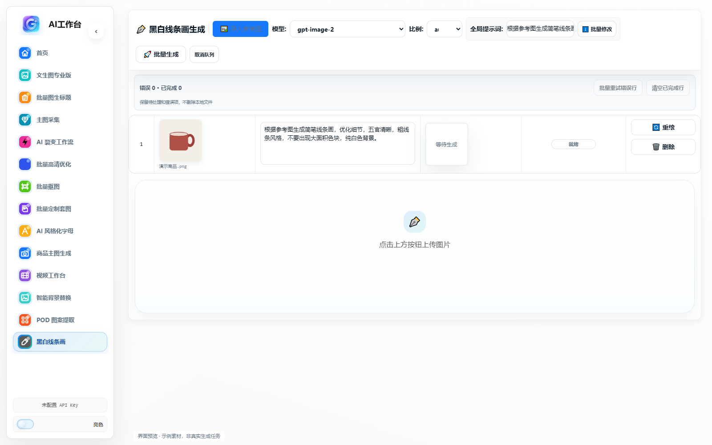

## 自定义接口

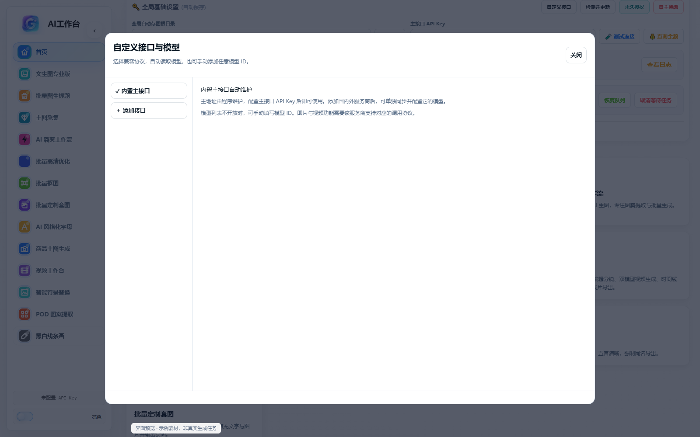

## 视频时间线与导出

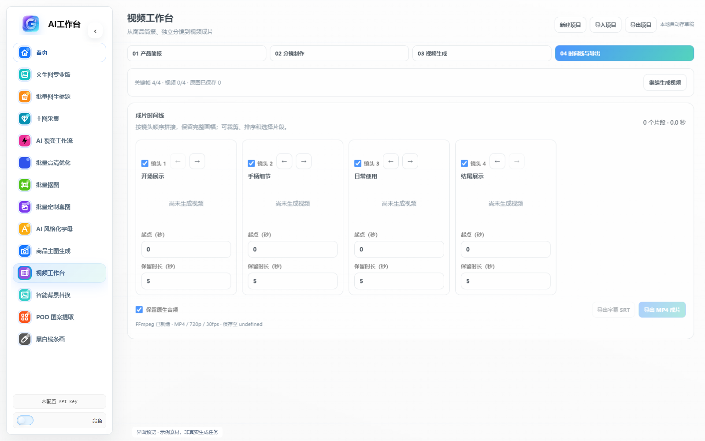
